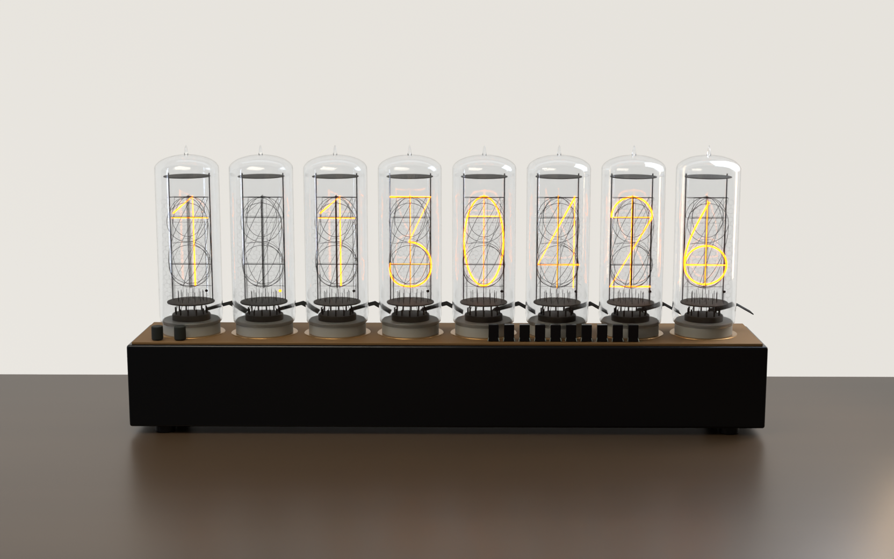

# Steins;Gate Divergence Meter · Blender

受《命运石之门》世界线变动率探测仪启发的非官方 Blender 三维动画工程。包含八只玻璃辉光管、十层数字阴极、琥珀金色发光、电子元件底座和桌面场景。



## 文件

- `当前工程/世界线探测仪.blend`：最新可编辑工程，已移除第三方音乐。
- `当前工程/动画时间.json`：数字跳转的启动、停止时间与变化次数。
- `当前工程/阴极层次说明.png`：阴极前后位置示意图。
- `制作脚本/渲染视频.py`：完整场景渲染、视频合成与解码检查。
- `LICENSE`：MIT 许可证。

## 效果

八管结构一致，每管具有 0–9 阴极和右下角小数点，演示仅第二管显示小数点。各数字具有固定的前后位置，发光跟随对应阴极，辅助十字比数字主体更细。

动画从 **1.130426 → 0.571024**。首管在此段仅 0/1 交替，其余数字逐次加 1 循环。3.8 秒开始依次变化，7.3 秒开始依次停止，最后一管 **8.4 秒**停止。各管变化速度接近每秒 20 次，为准确落到目标值略有差异。

模型是视觉重建，不是气体放电仿真；阴极排列顺序未经原作实物规格验证。动画为单向跳转，并非无缝循环。

## 打开与渲染

制作环境：**Blender 5.2.1 LTS / Windows / Cycles OptiX**。打开 `.blend` 后使用时间轴播放；渲染脚本目前配置 NVIDIA OptiX，其他显卡需自行修改设备设置。

脚本需要 FFmpeg 位于 PATH。未附带音乐时生成无声视频；如拥有适当授权，可自行放置 `参考素材/35_Leap (REBOOT).mp3`。

```powershell
& 'C:/Program Files/Blender Foundation/Blender 5.2/blender.exe' -b './当前工程/世界线探测仪.blend' --python './制作脚本/渲染视频.py'
```

输出为 2560×1600、60fps、约 15.38 秒，位于自动创建的 `交付视频` 目录。脚本会覆盖同名输出，渲染缓存位于 `缓存`。其他系统及 Blender 版本尚未验证。

## 许可证

原创脚本及贡献者有权授权的原创模型、材质、场景采用 [MIT License](LICENSE)。

《命运石之门》的名称、原作设计及其他第三方权利不在 MIT 授权范围内，相关权利属于各自权利人。项目为非官方同人重建，与原作权利人无隶属或授权关系。仓库不附带第三方音乐、原作截图或参考视频。
